# Buslogix — Documentación funcional del Backend

> Este documento explica **qué hace** el backend de Buslogix y **cómo funciona cada proceso**, en un lenguaje lo menos técnico posible. Los diagramas están en formato Mermaid (se ven como dibujos en GitHub y en VS Code con la extensión *Markdown Preview Mermaid Support*).

---

## Índice

1. [¿Qué es Buslogix?](#1-qué-es-buslogix)
2. [Vista general](#2-vista-general)
3. [Conceptos y palabras clave](#3-conceptos-y-palabras-clave)
4. [Seguridad: quién entra y qué puede hacer](#4-seguridad-quién-entra-y-qué-puede-hacer)
5. [Módulos de administración](#5-módulos-de-administración)
6. [El módulo de cobros (el corazón del sistema)](#6-el-módulo-de-cobros-el-corazón-del-sistema)
7. [Procesos automáticos](#7-procesos-automáticos)
8. [El recorrido completo de un pago](#8-el-recorrido-completo-de-un-pago)
9. [Registro de actividad (logs) y errores](#9-registro-de-actividad-logs-y-errores)
10. [Configuración necesaria](#10-configuración-necesaria)
11. [Observaciones encontradas durante la revisión](#11-observaciones-encontradas-durante-la-revisión)
12. [Anexo: lista de direcciones (endpoints)](#12-anexo-lista-de-direcciones-endpoints)

---

## 1. ¿Qué es Buslogix?

Buslogix es un sistema para **empresas de transporte escolar**. Les permite administrar todo su negocio desde un solo lugar:

- **La operación:** vehículos, choferes, rutas, mantenimientos, incidentes y viajes especiales.
- **El personal:** empleados, sus salarios y los usuarios que entran al sistema.
- **Los estudiantes:** quiénes son, en qué ruta y grado están y a quién contactar.
- **El dinero:** cuánto debe pagar cada estudiante, quién pagó, quién debe (morosos) y todos los gastos de la empresa.

Su característica más fuerte es la **automatización de cobros**:

1. El padre o madre de familia envía la **foto del comprobante de pago por WhatsApp**.
2. Un **bot** conversa con esa persona, identifica al estudiante y una **inteligencia artificial (Claude)** lee el monto y el número de referencia de la foto.
3. Al mismo tiempo, el sistema lee las **notificaciones del banco** que llegan por **correo electrónico** o **SMS**.
4. Cuando el comprobante del padre y la notificación del banco **coinciden** (misma referencia y mismo monto), el pago queda **validado** y, si la empresa lo permite, **se registra solo**, sin que nadie tenga que revisarlo.

El sistema es **multiempresa**: muchas empresas de transporte pueden usarlo a la vez y cada una solo ve su propia información.

---

## 2. Vista general

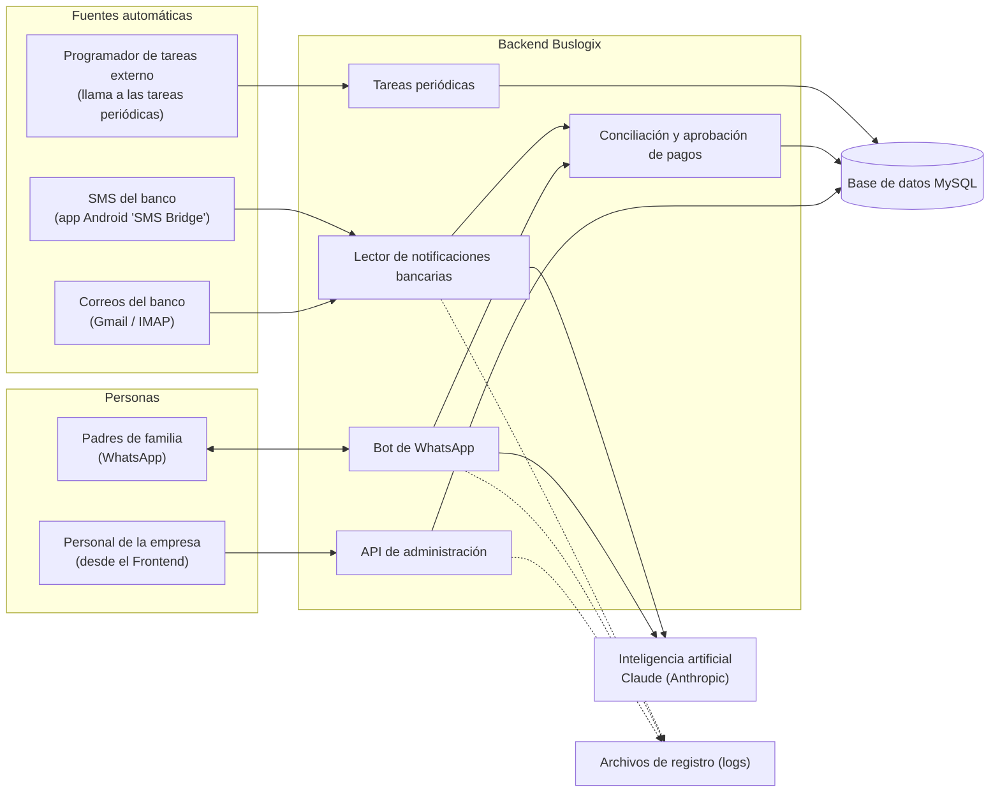

**Tecnología (solo como referencia):** .NET 9 (C#), base de datos MySQL con la mayor parte de las reglas de negocio en *procedimientos almacenados*, WhatsApp Business (API de Meta), Gmail por IMAP, y Claude de Anthropic como inteligencia artificial.

---

## 3. Conceptos y palabras clave

| Palabra | Qué significa en Buslogix |
|---|---|
| **Empresa** | Cada compañía de transporte que usa el sistema. Todo dato pertenece a una empresa. |
| **Usuario** | Persona que entra al sistema con usuario y contraseña. |
| **Rol** | Un "perfil" (ej. *Administrador*, *Contador*) que define qué puede ver o modificar un usuario. |
| **Usuario de proceso crítico** | Usuario de confianza. Solo ellos pueden borrar información o modificar datos sensibles (dinero, usuarios, permisos). |
| **Solicitud de periodo de pago** | La regla de cobro de la empresa: *cuánto* se cobra, *desde cuándo* y *cada cuántos días*. |
| **Periodo de pago** | Cada fecha concreta de cobro (ej. 1 de marzo, 31 de marzo...). Se generan automáticamente. |
| **Vacaciones** | Rangos de fechas en que **no se cobra**. |
| **Exoneración** | Descuento (en %) para un estudiante. Puede ser **periódica** (durante un rango de fechas) o **específica** (solo para un periodo de pago). |
| **Solicitud de pago** | Un comprobante enviado por un padre por WhatsApp que **todavía no es un pago oficial**. Espera validación y aprobación. |
| **Pago** | Dinero oficialmente registrado a favor de un estudiante. |
| **Referencia** | El número de transacción/folio del comprobante bancario. Es la "huella" que permite emparejar comprobante con notificación del banco. |
| **Notificación bancaria / extracción** | El aviso del banco (correo o SMS) del que el sistema "extrae" monto, referencia y fecha. |
| **Conciliación (matching)** | Comparar el comprobante del padre con la notificación del banco. |
| **Moroso (deudor)** | Estudiante que debe más de lo que ha pagado. |

---

## 4. Seguridad: quién entra y qué puede hacer

### 4.1 Inicio de sesión

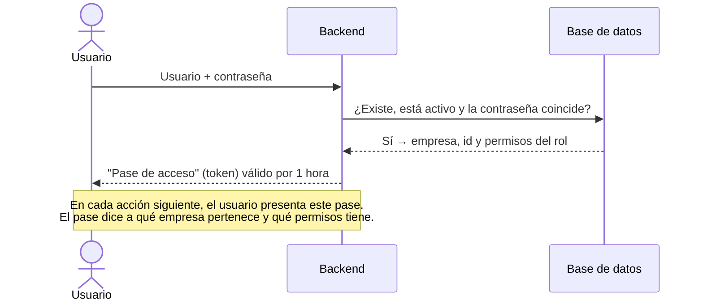

- El **pase (token)** dura **1 hora**; después hay que volver a iniciar sesión.
- Si el usuario está **inactivo**, no puede entrar.
- El pase incluye la **empresa** del usuario. El sistema usa ese dato para que **nunca** se vea información de otra empresa, aunque alguien lo intente.

### 4.2 Permisos (roles)

Cada rol tiene una lista de "recursos" (áreas del sistema) y para cada uno puede tener:

- **Lectura (READ):** solo ver.
- **Escritura (WRITE):** ver **y** crear/modificar. *Tener escritura implica tener lectura.*

Recursos disponibles:

| Recurso | Qué controla |
|---|---|
| COMPANY | Datos de la propia empresa |
| ROLE | Roles y sus permisos |
| USER | Usuarios del sistema |
| OWN_USER | El propio perfil (ver/editar mis datos, cambiar mi contraseña) |
| EMPLOYEE | Empleados y choferes |
| SALARY | Salarios de los empleados |
| VEHICLE | Vehículos |
| ROUTE | Rutas |
| GRADE | Grados escolares |
| STUDENT | Estudiantes (y sus códigos QR) |
| CONTACT | Contactos de los estudiantes |
| MAINTENANCE | Mantenimientos de vehículos |
| INCIDENT | Incidentes |
| CUSTOM_TRANSPORT | Transportes especiales |
| EXPENSE | Todos los tipos de gastos |
| PAYMENT_PERIOD | Reglas y periodos de cobro |
| VACATION | Vacaciones |
| SPECIFIC_EXEMPTION / PERIODIC_EXEMPTION | Exoneraciones |
| PAYMENT | Pagos |
| DEBTOR | Reporte de morosos (solo lectura) |
| PAYMENT_REQUEST | Ver solicitudes de pago (solo lectura) |
| PAYMENT_APPROVAL | Validar, aprobar o rechazar solicitudes de pago (solo escritura) |
| EMAIL_ACCOUNT / EMAIL_SENDER | Correos que el sistema lee y remitentes bancarios permitidos |
| WHATSAPP_ACCOUNT | Números de WhatsApp de la empresa |

### 4.3 Usuarios de proceso crítico (doble candado)

Además del permiso del rol, ciertas acciones **solo las puede hacer un usuario marcado como "de proceso crítico"**. Cada vez que uno de ellos hace algo así, queda una **advertencia en el registro** con quién lo hizo.

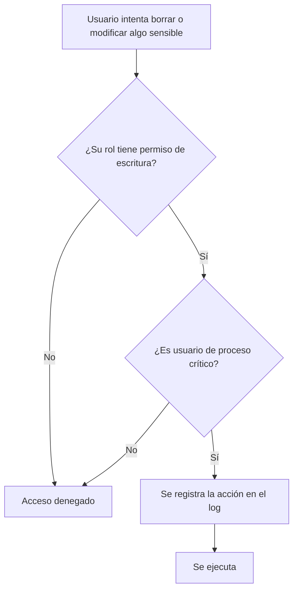

Acciones protegidas con este doble candado:

| Tipo | Acciones |
|---|---|
| **Borrar** | Usuarios, roles, empleados, salarios, estudiantes, contactos, vehículos, rutas, grados, mantenimientos, incidentes, transportes especiales, gastos, pagos, vacaciones, exoneraciones, reglas de cobro, cuentas de correo, remitentes, cuentas de WhatsApp |
| **Modificar** | Usuarios, permisos de un rol, pagos, gastos (todos los tipos), vacaciones, exoneraciones, reglas de cobro, transportes especiales |
| **Cambiar la lista de usuarios críticos** | Solo un usuario crítico. *Excepción:* si la empresa todavía no tiene ninguno, cualquier usuario con permiso de escritura sobre usuarios puede nombrar a los primeros. |

### 4.4 Servicios automáticos (clave de servicio)

Algunas direcciones no las usan personas, sino **programas** (la app de SMS o el programador de tareas). Estos se identifican con una **clave secreta de servicio** (`X-Api-Key`). Cada clave tiene un nombre y **solo sirve para su tarea**:

| Nombre del servicio | Única tarea que puede disparar |
|---|---|
| SmsIngestionService | Enviar SMS bancarios |
| EmailRetrievalService | Revisar correos bancarios |
| PaymentMatchingService | Barrido de conciliación |
| PaymentAutoApprovalService | Barrido de aprobación automática |
| PaymentPeriodSchedulingService | Generar el siguiente periodo de cobro |
| MessageExtractionRetryService | Reintentar notificaciones que fallaron |
| MessageExtractionPurgeService | Limpiar registros viejos |

El **webhook de WhatsApp** se protege de otra forma: Meta firma cada mensaje y el sistema verifica esa firma; si no coincide, lo rechaza.

---

## 5. Módulos de administración

Casi todos los módulos permiten **listar (con filtros y páginas), ver uno, crear, modificar y borrar**. Abajo se explica qué guarda cada uno y sus reglas particulares.

### 5.1 Empresa
- Ver y modificar **solo la propia empresa**: nombre, teléfono, correo, si está activa y si tiene **aprobación automática de pagos** activada.
- Si la empresa está inactiva, no se le generan periodos de cobro ni se le aprueban pagos automáticamente.

### 5.2 Usuarios
- Datos: usuario, rol, activo/inactivo y datos personales (cédula, nombre, apellido, dirección, teléfono, correo).
- **Al crear un usuario**, el sistema le **genera una contraseña aleatoria** de 10 caracteres (ver [observación 1](#11-observaciones-encontradas-durante-la-revisión)).
- **Mi perfil:** cada usuario puede ver y editar sus propios datos y **cambiar su contraseña** (solo la suya).
- **Olvidé mi contraseña:** con el nombre de usuario, el sistema genera una contraseña nueva.
- **Datos personales compartidos:** si una persona ya existe como empleado (misma cédula), al hacerla usuario se reutilizan sus datos personales. Si se borra el usuario pero sigue siendo empleado, sus datos personales se conservan (y viceversa).

### 5.3 Roles y permisos
- Crear roles con un nombre (ej. "Secretaria").
- Asignar a cada rol qué recursos ve (lectura) o modifica (escritura). La lista que se envía **reemplaza** la anterior: lo que no se incluye se le quita.

### 5.4 Empleados y choferes
- Datos: fecha de contratación, activo y datos personales.
- **Si se le indica número de licencia y fecha de vencimiento, el empleado queda registrado también como chofer.** Si luego se quitan esos datos, deja de ser chofer.
- **Salarios:** historial de salarios de cada empleado (monto y fecha desde la que rige). Se pueden agregar y borrar.

### 5.5 Vehículos
- Placa, marca, modelo, año, capacidad, kilometraje, fecha de adquisición, activo. Búsqueda por placa, marca o modelo.

### 5.6 Rutas y grados
- **Rutas:** nombre, descripción, activa.
- **Grados:** descripción (ej. "3.º primaria").
- Sirven para clasificar a los estudiantes y filtrar reportes.

### 5.7 Estudiantes y contactos
- Datos del estudiante: nombre, apellido, dirección, cédula, ruta, grado, activo. La **fecha de ingreso** se guarda sola (el día en que se registra) y es importante para el cálculo de deudas: **solo se le cobran periodos desde esa fecha**.
- **Códigos QR:** se pueden generar códigos QR para hasta **20 estudiantes a la vez**. Cada QR contiene el número interno del estudiante y lleva su nombre como descripción (útil, por ejemplo, para carnés).
- **Contactos:** teléfonos de cada estudiante (padre, madre, encargado) con descripción y estado activo.

### 5.8 Mantenimientos
- Tipos: **Preventivo**, **Correctivo**, **Inspección técnica**.
- Se registra el vehículo, la descripción y opcionalmente la **fecha programada**.
- Hay dos listas: **pendientes** (programados y sin completar) y **completados**.
- **Completar** un mantenimiento = indicar la fecha en que se hizo; sale de pendientes.

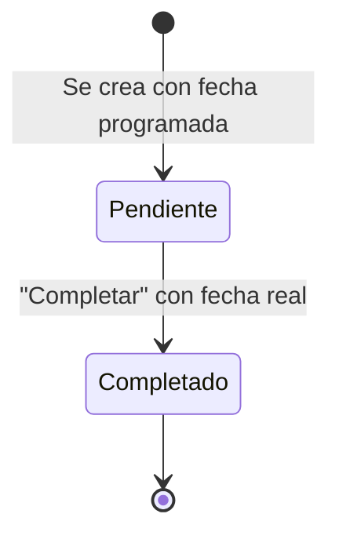

### 5.9 Incidentes
- Tipos: **Accidente**, **Avería**, **Retraso**, **Infracción de tránsito**, **Evento de seguridad**.
- Se registra vehículo, chofer, fecha, descripción y **acciones correctivas** tomadas.

### 5.10 Transportes especiales
- Viajes fuera de la operación normal (ej. una excursión): vehículo, chofer, **monto cobrado**, descripción y fecha programada.
- Igual que los mantenimientos: lista de **pendientes** y **completados**, y la acción **completar**.

### 5.11 Gastos
Hay un gasto "general" y cuatro tipos especiales. Todos comparten fecha, monto y descripción:

| Tipo | Dato adicional |
|---|---|
| Gasto general | — (la lista de generales **no** muestra los de otros tipos) |
| Combustible | Vehículo, chofer y litros |
| Mantenimiento | A qué mantenimiento corresponde |
| Salario | A qué empleado se le pagó |
| Incidente | A qué incidente corresponde |

Los cuatro tipos especiales se pueden crear, ver y modificar (no tienen opción propia de borrado).

### 5.12 Configuración de canales automáticos
- **Cuentas de correo:** el buzón donde llegan los avisos del banco (dirección, contraseña de aplicación, servidor y puerto IMAP, activo). Al listarlas **nunca** se muestra la contraseña.
- **Remitentes de correo:** las direcciones del banco de las que se aceptan correos (ej. `notificaciones@banco.com`). Correos de otros remitentes se ignoran.
- **Cuentas de WhatsApp:** el número de WhatsApp Business de la empresa (identificador de Meta + token de acceso, activo). Al listarlas **nunca** se muestra el token.

---

## 6. El módulo de cobros (el corazón del sistema)

### 6.1 ¿Cómo se define cuánto y cuándo se cobra?

La empresa crea una **solicitud de periodo de pago** (la "regla de cobro"):

- **Monto:** cuánto paga cada estudiante por periodo (ej. 1.500).
- **Fecha de inicio:** primer día de cobro.
- **Días hasta el siguiente pago:** cada cuántos días se repite (ej. 30).

A partir de esa regla, el sistema va creando **periodos de pago** (fechas concretas de cobro).

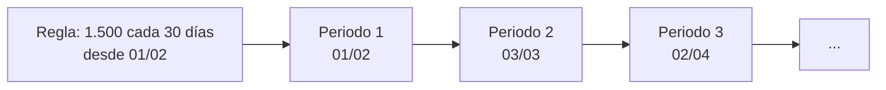

**Reglas importantes:**
- La **primera** regla de la empresa crea de inmediato el primer periodo en su fecha de inicio.
- Para **cambiar el monto o la frecuencia** se crea una **regla nueva**, y su fecha de inicio **debe ser exactamente la fecha del último periodo generado** (así no quedan huecos ni solapamientos). Si no coincide, se rechaza.
- Una regla **solo se puede modificar si todavía no generó ningún periodo**.
- El monto es el **mismo para todos los estudiantes** de la empresa; las diferencias se manejan con exoneraciones.

### 6.2 Generación automática de periodos

Una tarea periódica (ver [7.6](#76-generación-automática-de-periodos-de-cobro)) revisa cada empresa activa:

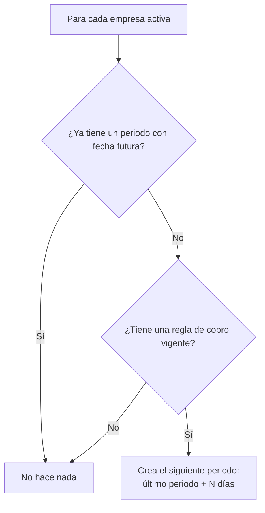

Cada ejecución crea **como máximo un periodo** por empresa, por eso conviene ejecutarla **una vez al día**.

### 6.3 Vacaciones
Rangos de fechas (con descripción) en que la empresa **no cobra**. Si un periodo de pago cae dentro de unas vacaciones, **no se cuenta como deuda** para nadie.

### 6.4 Exoneraciones (descuentos)
- **Periódica:** un % de descuento para un estudiante durante un rango de fechas (ej. "Hermano 2", 25 %, todo el año).
- **Específica:** un % de descuento para un estudiante en **un periodo concreto** (ej. "Enfermedad en abril", 100 %).
- Si se juntan varias, los porcentajes **se suman**, con un **tope de 100 %** (nunca se le "debe" dinero al estudiante).

### 6.5 Pagos
- Registro oficial de dinero recibido: fecha, monto, estudiante y referencia (opcional).
- Se pueden registrar **a mano** (ej. pago en efectivo) o se crean **automáticamente** al aprobar una solicitud de pago.
- **Regla de la referencia:** solo letras y números, de 1 a 50 caracteres, sin espacios ni símbolos. Una referencia **no puede repetirse**: si ya existe en otro pago o en una solicitud pendiente, el pago se rechaza. Esto evita registrar dos veces el mismo comprobante.

### 6.6 Solicitudes de pago (comprobantes de WhatsApp)

Una solicitud de pago es un comprobante que **aún no es pago oficial**. Su ciclo de vida:

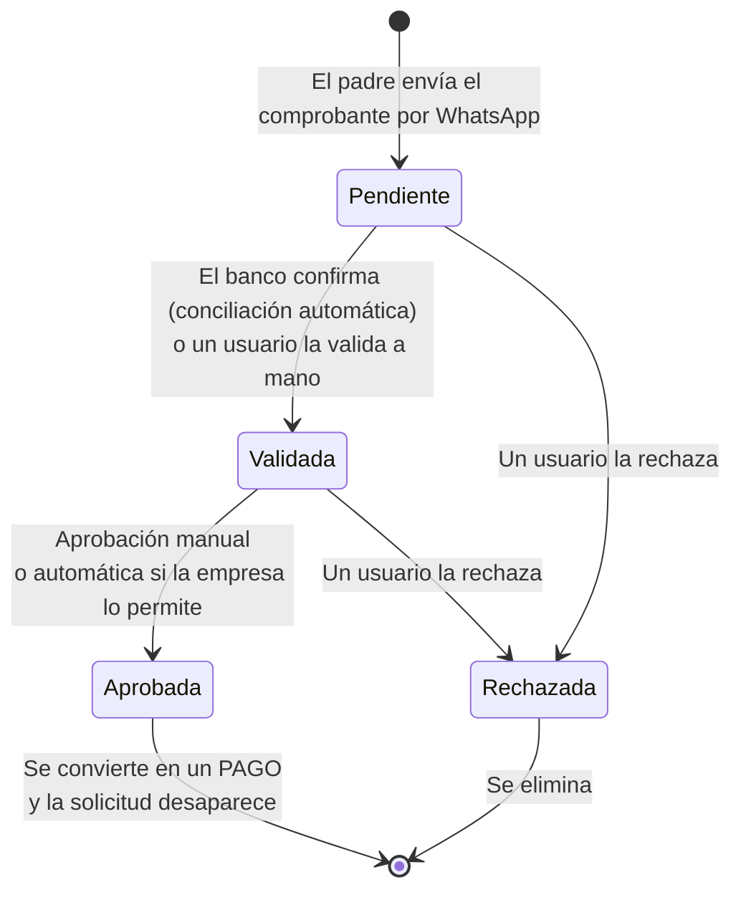

- **Validar** = confirmar que el dinero realmente llegó. Si la empresa tiene aprobación automática, al validarla **se aprueba sola** en ese momento.
- **Aprobar** = convertirla en pago oficial. **Solo se puede aprobar una solicitud ya validada.**
- **Rechazar** = eliminarla (ej. comprobante falso o duplicado).
- Una solicitud **sin referencia** (la IA no pudo leerla) **nunca se concilia sola**: alguien debe revisarla y validarla a mano.

### 6.7 Reporte de morosos

Muestra los estudiantes que **deben dinero**, con cuánto deben, cuántos periodos se les cobraron y cuántos pagos hicieron. Se puede filtrar por ruta, estudiante o estado activo.

**Cómo se calcula la deuda de cada estudiante:**

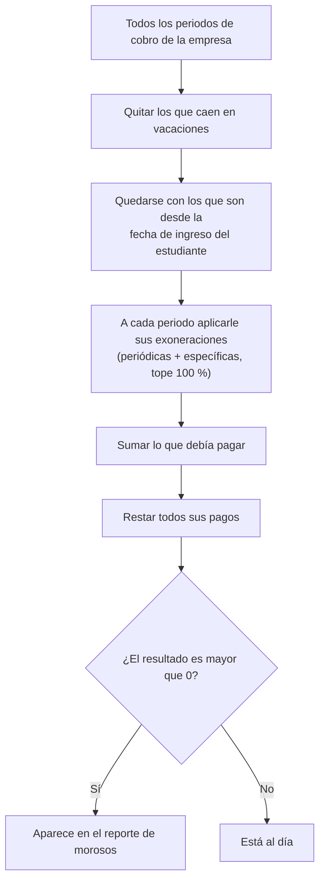

**Ejemplo:** cuota de 1.500; al estudiante le tocan 4 periodos; uno cayó en vacaciones (quedan 3); tiene una exoneración de 50 % en uno de ellos → debe 1.500 + 1.500 + 750 = **3.750**. Si pagó 3.000, aparece como moroso con **750** pendientes.

---

## 7. Procesos automáticos

Estos procesos trabajan "por detrás", sin que nadie los ejecute a mano. Hay dos tipos:

- **Inmediatos:** se ponen en una **fila de espera interna** y se procesan en segundos (mensajes de WhatsApp, notificaciones bancarias, conciliación).
- **Periódicos:** se ejecutan cuando un **programador externo** llama a su dirección con la clave de servicio. El sistema acepta la orden al instante y la realiza en segundo plano. Si llegan dos órdenes iguales mientras una está en curso, la segunda se descarta (no se duplica trabajo).

> ⚠️ El programador externo **no forma parte de este repositorio**. Hay que configurarlo aparte (ej. un cron o tarea programada del servidor) para que llame periódicamente a esas direcciones.

### 7.1 Bot de WhatsApp: recibir comprobantes de los padres

**Objetivo:** que el padre envíe su comprobante y quede registrado como solicitud de pago del estudiante correcto.

**Pasos de la conversación:**

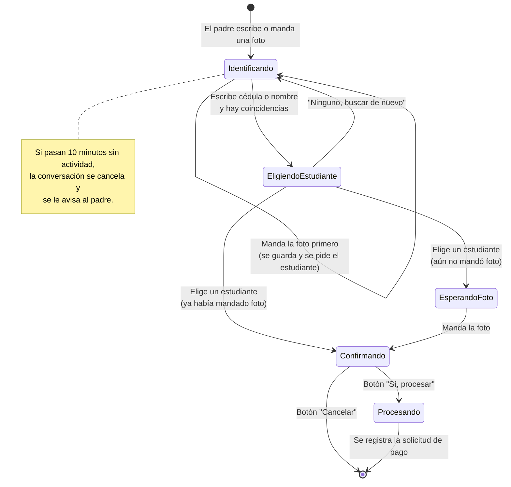

**Detalles de cada paso:**

1. **Identificación del estudiante**
   - Si el padre escribe **solo números**, se busca por **cédula**; si escribe letras, se busca por **nombre**.
   - Solo se buscan estudiantes **activos** de esa empresa, máximo **10 resultados**.
   - Se muestra una lista con el nombre y los **últimos 4 dígitos de la cédula** (para que el padre reconozca al correcto sin exponer el dato completo), más la opción "Ninguno, buscar de nuevo".
2. **Foto del comprobante**
   - Puede enviarse **antes o después** de identificar al estudiante.
   - Solo se procesa **una foto por conversación**; si manda otra, se le avisa que se usará la primera.
3. **Confirmación final:** se muestra un resumen ("Estudiante: X — Comprobante: recibido ✅") con botones **Sí, procesar** / **Cancelar**.
4. **Procesamiento** (en segundo plano):

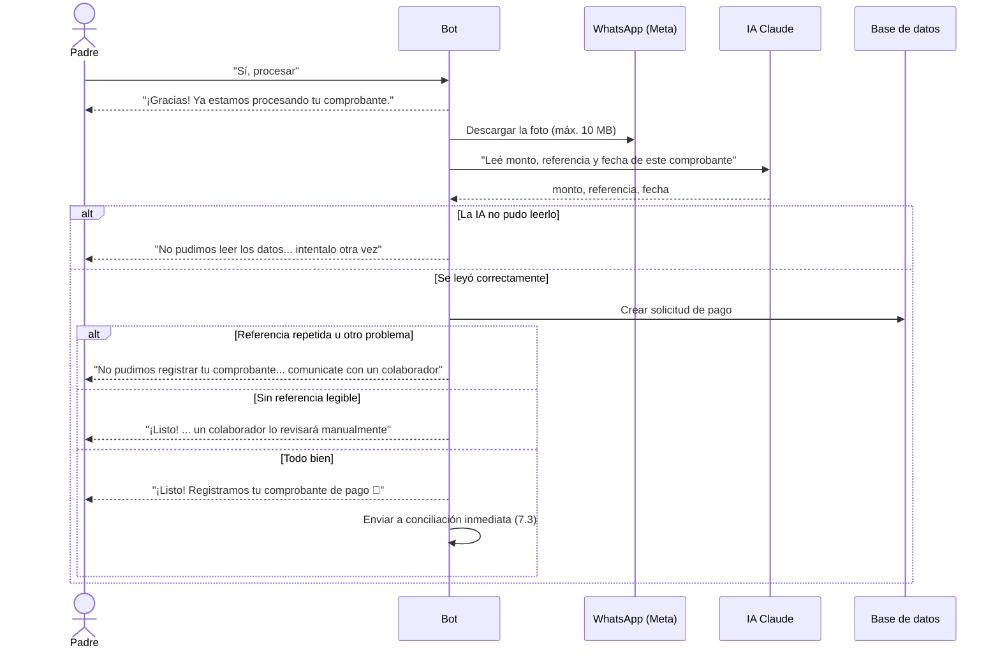

**A tener en cuenta:**
- Cada empresa tiene su propio número de WhatsApp; el sistema sabe de qué empresa es el mensaje por el número al que escribió el padre.
- Las conversaciones en curso se guardan **en memoria**: si el servidor se reinicia, las conversaciones abiertas se pierden y el padre debe empezar de nuevo.

### 7.2 Lectura de notificaciones bancarias (correo y SMS)

**Objetivo:** saber qué dinero **realmente llegó** a la cuenta de la empresa, leyendo los avisos del banco.

**Hay dos puertas de entrada:**

| Canal | Cómo llega |
|---|---|
| **Correo** | Cuando el programador externo lo ordena, el sistema entra a cada buzón configurado, busca correos **de los remitentes bancarios registrados** que **no** tengan la etiqueta `Buslogix/Processed` y que sean desde la última revisión (con una hora de margen). Convierte el correo en texto, lo envía a extracción y le pone la etiqueta para no volver a leerlo. |
| **SMS** | Un celular Android con la app **SMS Bridge** recibe los SMS del banco y los reenvía al backend junto con el número de empresa. |

**Extracción de datos (qué dice el mensaje):**

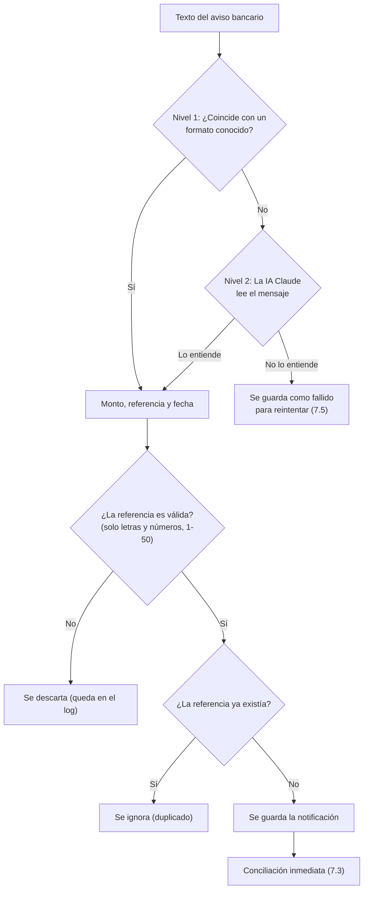

- **Nivel 1 – Formatos conocidos:** el archivo `extraction-patterns.json` contiene "plantillas" de mensajes bancarios. Hoy trae dos: *transferencia SPEI recibida* y *depósito en OXXO confirmado*. Se pueden agregar más **sin reiniciar el sistema** (el archivo se relee al cambiar).
- **Nivel 2 – Inteligencia artificial:** si ninguna plantilla sirve, se le pide a Claude que extraiga los datos. Es más flexible, pero cuesta dinero por uso. Si la cuenta de Anthropic se queda **sin crédito**, se registra un error para que alguien la recargue.
- Las notificaciones guardadas que no se concilian se **borran a los 3 días** (ver 7.5).

### 7.3 Conciliación de pagos (matching)

**Objetivo:** emparejar el comprobante del padre con la notificación del banco.

**Regla:** se considera que coinciden si son de la **misma empresa**, tienen la **misma referencia** y el **mismo monto**.

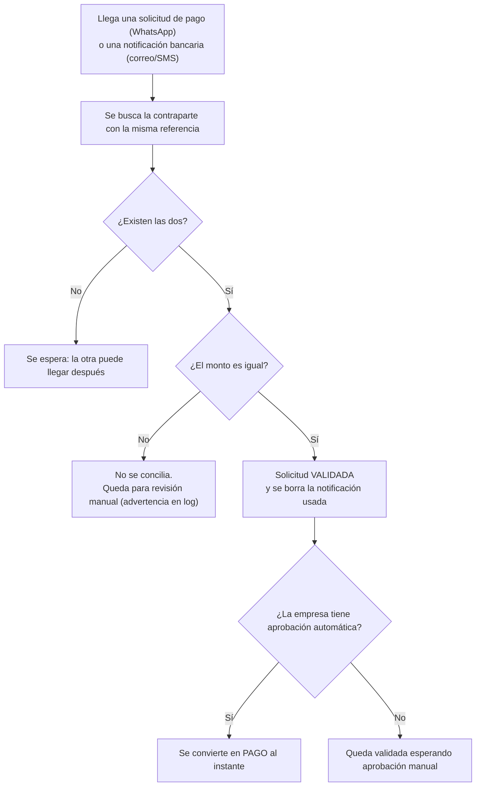

- No importa **cuál llega primero**: cuando llega la segunda, se dispara la conciliación.
- Además existe un **barrido general** (`match-pending`) que el programador externo puede ejecutar para conciliar de una vez todo lo que haya quedado pendiente.

### 7.4 Aprobación automática

- Si la empresa tiene activada la **aprobación automática**, toda solicitud validada se convierte en pago **en el mismo momento** de la validación.
- Además hay un **barrido** (`auto-approve`) que busca solicitudes validadas que hayan quedado sin aprobar (por ejemplo, si la empresa activó la opción después) y las aprueba todas.
- Al aprobarse: se crea el **pago**, se guarda su referencia (para que no se pueda reutilizar) y se **elimina la solicitud**.

### 7.5 Reintentos y limpieza

| Tarea | Qué hace |
|---|---|
| **Reintentar fallidos** (`retry-failures`) | Toma todas las notificaciones bancarias que fallaron al leerse y las vuelve a procesar **una sola vez más**. Si vuelven a fallar, se registran en el log pero **no** se guardan otra vez (para evitar un ciclo infinito). |
| **Limpieza** (`purge-history`) | Borra las notificaciones fallidas y las notificaciones no conciliadas con **más de 3 días** de antigüedad. |

### 7.6 Generación automática de periodos de cobro

Ver la explicación en [6.2](#62-generación-automática-de-periodos). Se dispara con `payment-periods/schedule`.

### 7.7 Resumen de tareas periódicas

| Tarea | Dirección | Frecuencia sugerida |
|---|---|---|
| Revisar correos bancarios | `POST /email-ingestion/poll` | Cada pocos minutos |
| Barrido de conciliación | `POST /payment-requests/match-pending` | Cada hora (respaldo) |
| Barrido de aprobación automática | `POST /payment-requests/auto-approve` | Cada hora (respaldo) |
| Generar periodo de cobro | `POST /payment-periods/schedule` | Una vez al día |
| Reintentar notificaciones fallidas | `POST /message-extraction/retry-failures` | Algunas veces al día |
| Limpiar registros viejos | `POST /message-extraction/purge-history` | Una vez al día |

*(Las frecuencias son sugerencias; el código no las define.)*

---

## 8. El recorrido completo de un pago

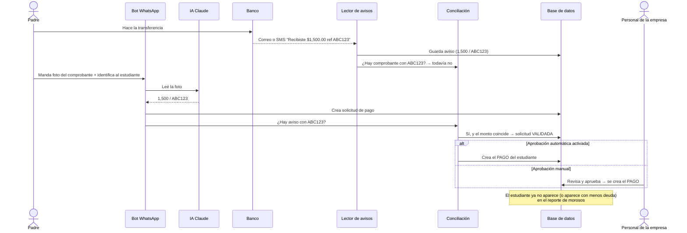

---

## 9. Registro de actividad (logs) y errores

- Todo queda escrito en archivos de texto en la carpeta `Logs/` (un archivo por día, se guardan **30 días**).
- Cada línea incluye un **código de solicitud** (para seguir una operación de principio a fin) y la **empresa** involucrada.
- Se registran: errores, advertencias (ej. montos que no coinciden, firmas inválidas de WhatsApp, acciones de procesos críticos) y resúmenes de cada tarea automática (ej. "Revisión de correo: 2 cuentas, 5 mensajes encontrados, 5 enviados a extracción").
- Si ocurre un error inesperado, el usuario recibe un mensaje genérico ("An unexpected error occurred.") y el detalle queda **solo en el log**, para no exponer información interna.

---

## 10. Configuración necesaria

| Configuración | Para qué sirve |
|---|---|
| Conexión a MySQL | Base de datos |
| JWT (clave, emisor, audiencia) | Firmar los pases de acceso de los usuarios |
| `ServiceApiKeys` | Las claves de cada servicio automático (hoy están **vacías**, por lo que ningún servicio puede entrar hasta configurarlas) |
| `LlmFallback:ApiKey` | Clave de Anthropic para usar la IA (obligatoria: sin ella el sistema no arranca) |
| `LlmFallback:Model` y `PromptTemplate` | Modelo de IA y la instrucción usada para leer avisos bancarios |
| `WhatsApp:VerifyToken`, `AppSecret`, `ApiVersion` | Conexión con WhatsApp Business (verificación del webhook y de las firmas) |
| `extraction-patterns.json` | Plantillas de mensajes bancarios conocidos |
| `FileLogging` | Ubicación y cantidad de días de los logs |

---

## 11. Observaciones encontradas durante la revisión

Esto **no** es una auditoría completa; son puntos que saltaron a la vista al leer el código y conviene revisar:

1. **Las contraseñas generadas no le llegan a nadie.** Al crear un usuario o al usar "olvidé mi contraseña", el sistema genera una contraseña aleatoria pero no la devuelve ni la envía por correo/SMS (el código de notificación está vacío). En la práctica, el usuario no puede conocer su contraseña.
2. **Error al crear un usuario que ya es empleado.** El procedimiento `insert_user` intenta actualizar una columna `first_name` que no existe en la tabla de datos personales (se llama `name`). Si la cédula ya está registrada (ej. un empleado al que se quiere dar acceso), la creación falla. ✅ *Corregido (2026-11-28): ver migración `2026-11-28_insert_user_personal_data_name.sql`.*
3. **Contraseñas guardadas sin cifrar** y con máximo 10 caracteres.
4. **Datos sensibles en `appsettings.json`:** la clave de firma JWT y la contraseña de la base de datos están dentro del repositorio.
5. **Tareas automáticas sin programador:** las claves de servicio están vacías y no hay en el repositorio ningún programador que llame a las tareas periódicas; hay que configurarlo aparte.
6. **Conversaciones de WhatsApp en memoria:** se pierden si el servidor se reinicia.
7. **Referencias únicas entre todas las empresas:** una referencia bancaria no puede repetirse ni siquiera entre empresas distintas. Es poco probable que choquen, pero si pasara, el segundo comprobante sería rechazado como duplicado.
8. **El SMS indica a qué empresa pertenece:** la app de SMS envía el número de empresa y el backend confía en él; cualquiera con la clave del servicio SMS podría enviar avisos a nombre de otra empresa.

---

## 12. Anexo: lista de direcciones (endpoints)

**Leyenda:** 🔓 sin sesión · 👤 requiere sesión y permiso · 🔒 además requiere usuario de proceso crítico · 🤖 solo servicio automático (clave de servicio) · 📲 solo WhatsApp (firma de Meta)

| Módulo | Acción | Dirección | Acceso |
|---|---|---|---|
| Usuarios | Iniciar sesión | `POST /users/authenticate` | 🔓 |
| | Olvidé mi contraseña | `POST /users/reset-password` | 🔓 |
| | Listar / ver | `GET /users`, `GET /users/{id}` | 👤 USER.READ |
| | Crear | `POST /users` | 👤 USER.WRITE |
| | Modificar / borrar | `PUT`/`DELETE /users/{id}` | 🔒 |
| | Ver / editar mi perfil | `GET`/`PUT /users/{id}/own` | 👤 OWN_USER |
| | Cambiar mi contraseña | `PUT /users/{id}/password` | 👤 OWN_USER.WRITE |
| | Usuarios críticos (ver / cambiar) | `GET`/`PUT /users/critical-process` | 👤 / 🔒 |
| Empresa | Ver / modificar la propia | `GET`/`PUT /companies/{id}` | 👤 COMPANY |
| Roles | Listar, ver, crear, modificar | `/roles` | 👤 ROLE |
| | Borrar | `DELETE /roles/{id}` | 🔒 |
| | Ver / cambiar permisos | `GET`/`PUT /roles/{id}/permissions` | 👤 / 🔒 |
| Empleados | Listar, ver, crear, modificar | `/employees` | 👤 EMPLOYEE |
| | Borrar | `DELETE /employees/{id}` | 🔒 |
| Salarios | Listar, crear | `/employees/{id}/salaries` | 👤 SALARY |
| | Borrar | `DELETE /employees/{id}/salaries/{id}` | 🔒 |
| Vehículos | Listar, ver, crear, modificar | `/vehicles` | 👤 VEHICLE |
| | Borrar | `DELETE /vehicles/{id}` | 🔒 |
| Rutas | Listar, ver, crear, modificar | `/routes` | 👤 ROUTE |
| | Borrar | `DELETE /routes/{id}` | 🔒 |
| Grados | Listar, ver, crear, modificar | `/grades` | 👤 GRADE |
| | Borrar | `DELETE /grades/{id}` | 🔒 |
| Estudiantes | Listar, ver, crear, modificar | `/students` | 👤 STUDENT |
| | Generar QR | `POST /students/qr-codes` | 👤 STUDENT.READ |
| | Borrar | `DELETE /students/{id}` | 🔒 |
| Contactos | Listar, crear, modificar | `/students/{id}/contacts` | 👤 CONTACT |
| | Borrar | `DELETE /students/{id}/contacts/{id}` | 🔒 |
| Mantenimientos | Pendientes / completados / ver | `GET /maintenances/pending`, `/completed`, `/{id}` | 👤 MAINTENANCE |
| | Crear, modificar, completar | `POST /maintenances`, `PUT /{id}`, `PUT /{id}/complete` | 👤 MAINTENANCE.WRITE |
| | Borrar | `DELETE /maintenances/{id}` | 🔒 |
| Incidentes | Listar, ver, crear, modificar | `/incidents` | 👤 INCIDENT |
| | Borrar | `DELETE /incidents/{id}` | 🔒 |
| Transportes especiales | Pendientes / completados / ver / crear / completar | `/custom-transports` | 👤 CUSTOM_TRANSPORT |
| | Modificar / borrar | `PUT`/`DELETE /custom-transports/{id}` | 🔒 |
| Gastos | Listar, ver, crear | `/expenses`, `/fuel-expenses`, `/maintenance-expenses`, `/salary-expenses`, `/incident-expenses` | 👤 EXPENSE |
| | Modificar (todos) / borrar (general) | `PUT .../{id}`, `DELETE /expenses/{id}` | 🔒 |
| Reglas de cobro | Listar, ver, crear | `/payment-period-requests` | 👤 PAYMENT_PERIOD |
| | Modificar / borrar | `PUT`/`DELETE /payment-period-requests/{id}` | 🔒 |
| Periodos de cobro | Listar | `GET /payment-periods` | 👤 PAYMENT_PERIOD.READ |
| | Generar siguiente | `POST /payment-periods/schedule` | 🤖 |
| Vacaciones | Listar, ver, crear | `/vacation` | 👤 VACATION |
| | Modificar / borrar | `PUT`/`DELETE /vacation/{id}` | 🔒 |
| Exoneraciones | Listar, ver, crear | `/periodic-exemptions`, `/specific-exemptions` | 👤 *_EXEMPTION |
| | Modificar / borrar | `PUT`/`DELETE .../{id}` | 🔒 |
| Pagos | Listar, ver, crear | `/payments` | 👤 PAYMENT |
| | Modificar / borrar | `PUT`/`DELETE /payments/{id}` | 🔒 |
| Solicitudes de pago | Listar, ver | `GET /payment-requests`, `/{id}` | 👤 PAYMENT_REQUEST.READ |
| | Validar / aprobar / rechazar | `POST /payment-requests/{id}/validate`, `/approve`, `/reject` | 👤 PAYMENT_APPROVAL.WRITE |
| | Barridos automáticos | `POST /payment-requests/match-pending`, `/auto-approve` | 🤖 |
| Reportes | Morosos | `GET /reports/debtors` | 👤 DEBTOR.READ |
| Correo | Cuentas (listar, crear, modificar) | `/email-accounts` | 👤 EMAIL_ACCOUNT |
| | Remitentes (listar, crear, modificar) | `/email-senders` | 👤 EMAIL_SENDER |
| | Borrar cuenta / remitente | `DELETE .../{id}` | 🔒 |
| | Revisar correos | `POST /email-ingestion/poll` | 🤖 |
| SMS | Recibir SMS bancario | `POST /sms-ingestion/receive` | 🤖 |
| Extracción | Reintentar / limpiar | `POST /message-extraction/retry-failures`, `/purge-history` | 🤖 |
| WhatsApp | Cuentas (listar, crear, modificar) | `/whatsapp-accounts` | 👤 WHATSAPP_ACCOUNT |
| | Borrar cuenta | `DELETE /whatsapp-accounts/{id}` | 🔒 |
| | Verificación del webhook | `GET /whatsapp-webhook` | 🔓 (token de verificación) |
| | Mensajes entrantes | `POST /whatsapp-webhook` | 📲 |
